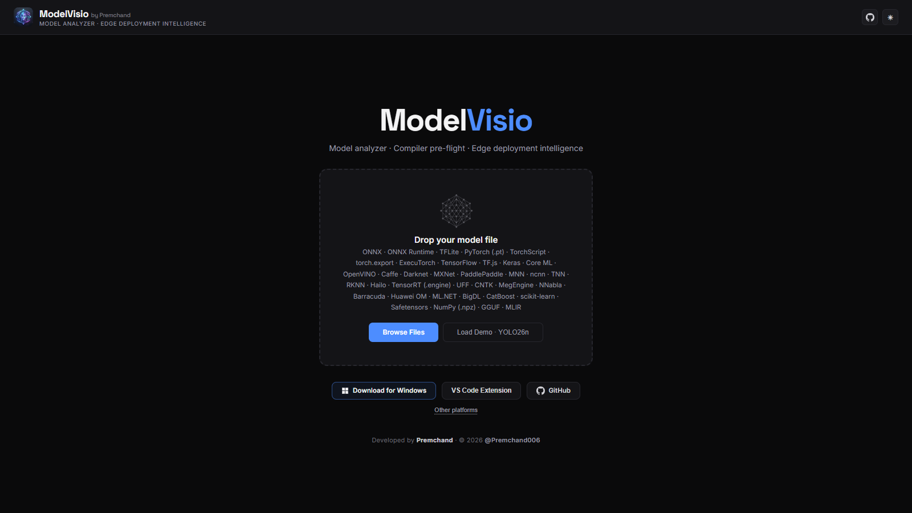
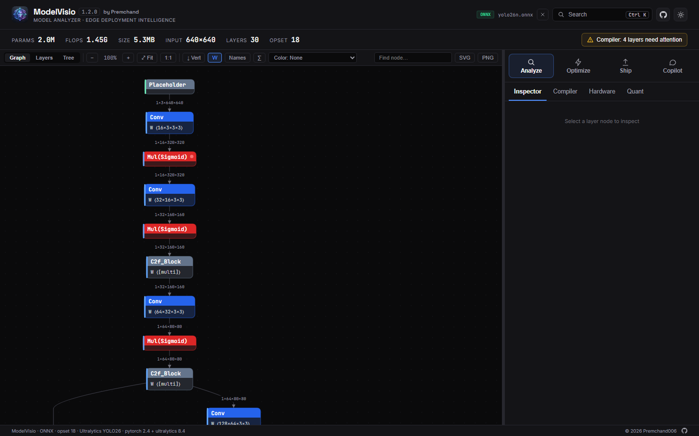
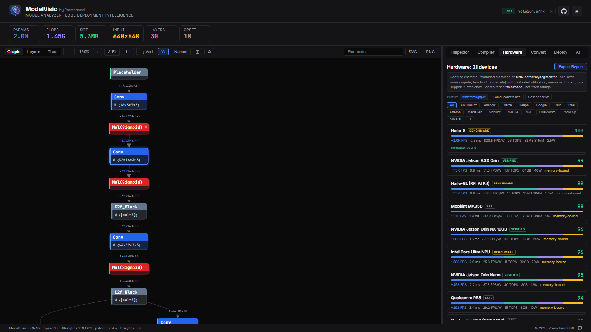
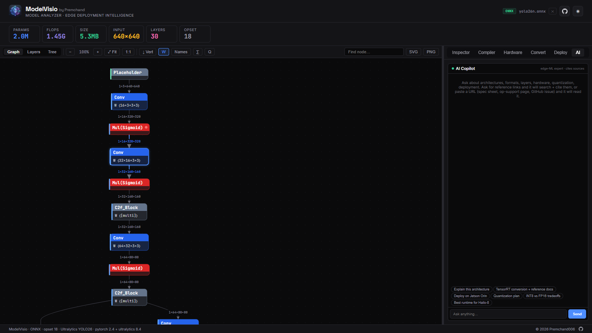
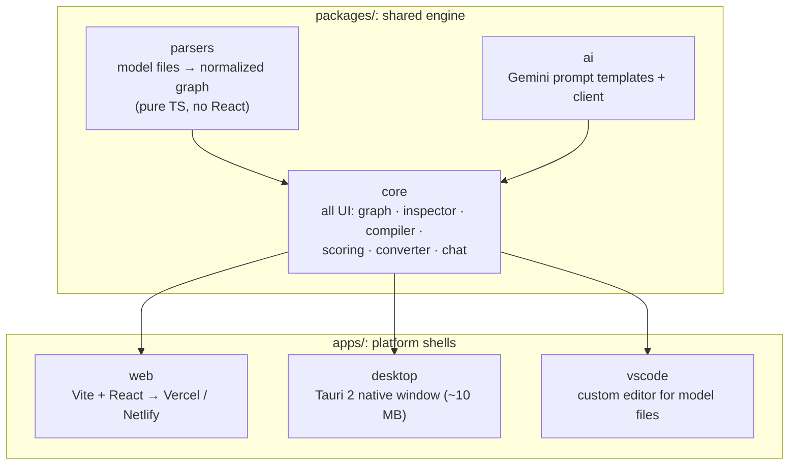
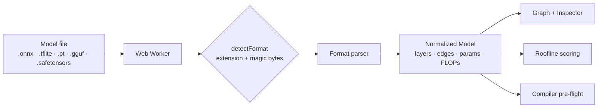
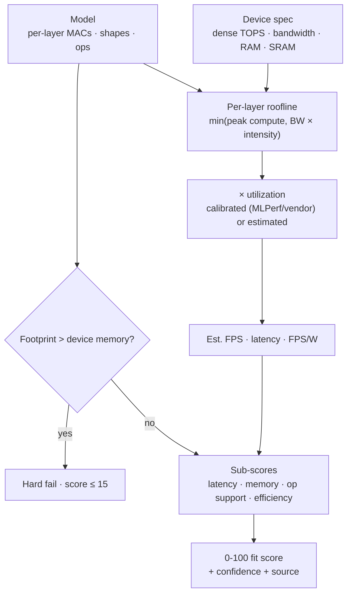
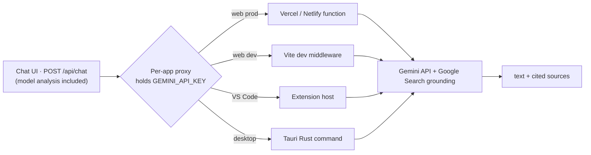

<p align="center">
  
</p>

<h1 align="center">ModelVisio</h1>

<p align="center">
  Neural-network model analyzer for edge deployment.<br/>
  A Netron-style graph viewer, an edge hardware advisor and an AI copilot in one tool.
  It ships as a website, a desktop app and a VS Code extension, all built from the same code.
</p>

<p align="center">
  
  
  
  
  
  
  
</p>

## What it is

Getting a trained model onto edge hardware involves a lot of guesswork. Which accelerator should
you use? Will the model fit in memory? Which ops fall back to the CPU? How fast will it run?
ModelVisio answers these from the model file itself. Drop in a model and you get, in the browser:

- an interactive graph of the model with a per-layer inspector
- a compiler pre-flight that flags op-support problems for each target, plus auto-fixes you can undo
- a hardware-fit score for 21 edge accelerators based on a roofline model (estimated FPS, FPS/W, memory fit)
- format conversion and copy-paste deploy scripts
- an AI copilot that sees the computed analysis of your model when it answers

All product logic lives in `packages/`. The web, desktop and VS Code apps mount it unchanged, so a
fix in the core reaches all three.

## Download the desktop app

| OS | Installer |
|---|---|
| macOS (Apple Silicon and Intel) | [ModelVisio-macOS-universal.dmg](https://github.com/Premchand006/ModelVisio/releases/latest/download/ModelVisio-macOS-universal.dmg) |
| Windows (x64) | [ModelVisio-Windows-x64-setup.exe](https://github.com/Premchand006/ModelVisio/releases/latest/download/ModelVisio-Windows-x64-setup.exe) |
| Linux (x86_64) | [ModelVisio-Linux-x86_64.AppImage](https://github.com/Premchand006/ModelVisio/releases/latest/download/ModelVisio-Linux-x86_64.AppImage). `.deb` and `.rpm` are on the [Releases](https://github.com/Premchand006/ModelVisio/releases/latest) page. |

**macOS:** open the `.dmg` and drag ModelVisio into Applications. The app isn't notarized yet, so
macOS blocks the first launch. Open it once, then go to System Settings > Privacy & Security and
click **Open Anyway**. On macOS 14 and older, Control-click the app and choose **Open** instead. You
can also run `xattr -dr com.apple.quarantine /Applications/ModelVisio.app`.
For troubleshooting, updates and uninstalling, see [docs/install-macos.md](docs/install-macos.md).

## Screenshots

| | |
|---|---|
|  |  |
|  |  |

## Features

| Feature | What it does |
|---|---|
| Graph and inspector | Netron-style DAG (dagre layout) with per-layer shapes, weights, FLOPs/MACs and quantization sensitivity. Exports to SVG or PNG. |
| Compiler pre-flight | Rule-based op-support checks for every parsed model against the vendors' documented limits (Coral Edge TPU op list and tensor rules; data-dependent ops and dynamic shapes on RKNN, Hailo and Kneron), plus memory warnings, shown on the graph. It flags known problems only; the vendor compiler has the final word. |
| Auto-fix | Graph transforms you can undo: SiLU to HardSwish, SPPF to parallel SPP, Resize to ConvTranspose, channel pruning. The graph, stats and compatibility results update as you apply them. |
| Hardware-fit scoring | Roofline model for 21 edge accelerators: estimated FPS, FPS/W, whether the model is compute- or memory-bound, a memory-fit check and op-support coverage. Each device is marked as calibrated or estimated. |
| Converter | Graph JSON, Layers CSV, Safetensors and NumPy exports in the browser, plus conversion kits for native toolchains. |
| Deploy scripts | Ready-to-run TensorRT, HailoRT and RKNN deployment scripts. |
| AI copilot | Google Gemini, given your model's computed analysis, with Google Search citations. The API key never reaches the browser. |
| Quantization heatmap | Per-layer INT8/INT4 sensitivity estimated from weight statistics and op type, shown as a graph colour overlay. Exports a mixed-precision plan for ONNX Runtime or TFLite. |
| Model advisor | Ranked, device-specific recommendations (quantization plan, op fixes, input resolution, memory-bound layers), each with estimated latency and size impact. |
| Benchmark | Runs ONNX models on this device with `onnxruntime-web` (WebAssembly, WebGPU or WebNN) in a Web Worker: latency percentiles, throughput, optional per-op profile, compared with the roofline prediction. The CPU runtime (14 MB) ships with the app; the WebGPU/WebNN runtime (27 MB) is downloaded from a version-pinned CDN URL on first use and checked against its SHA-256. |
| Performance investigator | Finds the bottleneck layers and patterns for a target device, then asks the AI for ranked hypotheses that must cite that evidence. Falls back to a rule-based report without a key. |
| Optimization search | Searches device × runtime × precision × auto-fix × input-size combinations and shows the Pareto frontier of latency, size and accuracy risk. |
| Deployment agent | Plans a deployment from a goal ("Jetson Orin Nano at ≥30 FPS") with tool calls, and produces a ZIP with conversion, inference and validation scripts. Has a rule-based planner when no AI key is set. |
| Fleet simulation | Estimates latency, queueing delay, SLO attainment, memory fit and energy across a mixed fleet of devices, with optional seeded Monte-Carlo variance. |
| Model registry | Local registry of model versions (hash, stats, compatibility, estimates) with version diffs and JSON import/export. |
| CLI and GitHub Action | `modelvisio inspect / check / diff / registry` for CI, with budget and regression gates and JUnit or Markdown reports. See [docs/ci](docs/ci/README.md). |

## Architecture



## How it works

### Parsing

Every parser produces the same `Model` shape (`{ layers, edges, stats… }`), so the graph, inspector
and scoring work the same way whatever the source format is. Files are parsed in a Web Worker so the
UI doesn't freeze on large models.



### Hardware-fit scoring

The 0-100 score is computed from the model. It uses the roofline model (Williams, Waterman and
Patterson, CACM 2009): for each layer, attainable throughput is
`min(peak_compute, bandwidth × arithmetic_intensity)`. The per-layer results are summed and then
scaled down by a utilization factor for the workload type. Where public benchmarks exist (NVIDIA
Jetson AGX Orin and Hailo-8, from MLPerf and vendor ResNet-50 numbers) the factor is calibrated
against them. Elsewhere it is an estimate, and the UI says which one you are looking at. If a model's
memory footprint is larger than the device's memory, the score is capped at 15 so it can never show
as a good fit.



The research behind the device numbers and weights is in
[docs/roofline-scoring-research.md](docs/roofline-scoring-research.md).

### AI copilot

The chat request is the same in every app. Only the proxy that holds the API key changes, and the
key never reaches the browser or WebView. It lives in a serverless function (web), a Vite dev
middleware (local development), the extension host (VS Code) or the Tauri Rust side (desktop).
Each request includes a summary of the model's analysis: the top device scores, bottleneck and
quantization-sensitive layers, and compiler issues. That lets the copilot answer about your model
rather than in general terms.



You can paste a URL into a chat message (a vendor op-support page, a spec sheet, a GitHub issue).
The server-side `/api/scrape` proxy fetches it, strips it down to readable text and passes it to the
model as untrusted context for that turn and the ones after it. The scraper refuses private,
loopback and cloud-metadata addresses, including hostnames that resolve to them and any redirect
that leads to them, and it limits size, time and content type. To restrict it to known docs sites,
set `MODELVISIO_SCRAPE_ALLOWLIST` (in VS Code, the `modelvisio.scrapeAllowlist` setting). URL
reading works on the web, in VS Code and in the desktop app, where a Rust command does the fetch
and pins each connection to the addresses that passed the check.

## Quick start

```bash
# needs Node 18+ and pnpm 10+
pnpm install
pnpm dev          # web app at http://localhost:5173
```

Click **Load Demo · YOLO26n** to try it without a file, or drop in your own model.

### Turning on the AI copilot

1. Get a free Gemini key at <https://aistudio.google.com/apikey>. No billing is needed.
2. Copy `.env.example` to `.env` in the repo root and set the key:
   ```bash
   GEMINI_API_KEY=your-key-here
   ```
3. Restart `pnpm dev` and open the **AI** tab. `MODELVISIO_MODEL` and `MODELVISIO_WEB_SEARCH` are optional.

The key stays on the server. See [Security](#security).

## Web, desktop and VS Code

| App | Develop | Build and release |
|---|---|---|
| Web | `pnpm dev` | `pnpm --filter @modelvisio/web build`, then deploy to Vercel (Root Directory `apps/web`, set `GEMINI_API_KEY`) or Netlify (`netlify.toml` is included) |
| Desktop (Tauri 2) | `pnpm --filter @modelvisio/desktop dev` | `pnpm --filter @modelvisio/desktop build`. Needs the [Rust toolchain](https://rustup.rs). Push a `desktop-v*` tag to build installers with GitHub Actions. The desktop app adds File → Open Recent. |
| VS Code | Open `apps/vscode` as the workspace folder and press F5 | `pnpm package:vscode` produces `apps/vscode/modelvisio.vsix`. Push a `vscode-v*` tag to attach it to a GitHub Release (and publish to the Marketplace if `VSCE_PAT` is set). |

### VS Code extension

The extension opens model files in a custom editor that runs the same app. Extensions that only
model files use (`.onnx`, `.tflite`, `.pt`, `.safetensors`, `.gguf` and others) open in ModelVisio
by default. Generic ones (`.json`, `.bin`, `.xml`, `.pb`, `.h5` and others) keep their usual editor,
and you can right-click and choose **Open with ModelVisio**. Parsing runs in a Web Worker, the view
reloads when the file changes, and exports open a native Save dialog. To use the AI copilot, run
**ModelVisio: Set Gemini API Key**. The key is stored in VS Code's encrypted Secret Storage and is
never sent to the WebView.

```bash
pnpm build:vscode                         # out/extension.js (esbuild) + media/ (vite)
pnpm --filter modelvisio-vscode test      # host and webview unit tests
pnpm package:vscode                       # builds apps/vscode/modelvisio.vsix
code --install-extension apps/vscode/modelvisio.vsix
```

Commands, settings, privacy details and architecture are in [apps/vscode/README.md](apps/vscode/README.md).

## Supported formats

All parsers produce the normalized `Model`. Fully parsed formats show a complete graph. The others
are detected and shown as metadata, and the UI labels them that way (see `FORMAT_SUPPORT`).

| Fully parsed | Detected (metadata only) |
|---|---|
| ONNX, TFLite, PyTorch (`.pt`/`.pth`), Safetensors, GGUF, NumPy, Darknet, Core ML (`.mlmodel`, zipped `.mlpackage`), OpenVINO IR, TensorFlow (GraphDef, SavedModel, `.pbtxt`), Keras (`.keras`, `.h5`), Caffe, PaddlePaddle (`.pdmodel`), ncnn, MNN, RKNN, MLIR, scikit-learn | Compiled Core ML (`.mlmodelc`), Paddle params / Paddle Lite, TorchScript, ExecuTorch, TensorRT engines and the other formats in `FORMAT_SUPPORT` |

Formats whose weights live in a separate file (OpenVINO `.bin`, ncnn `.bin`, Paddle `.pdiparams`,
TF.js shards, SavedModel `variables/`) read it for weight statistics. VS Code, the desktop app and the
CLI load it from the model's folder automatically; in the browser, select or drop both files
together. Without it the graph, shapes and parameter counts are complete and a note says which file
would add the statistics. A Keras architecture JSON with a separate `model.weights.h5` is not read
yet (`.keras` and full `.h5` files carry their weights).

ONNX models without intermediate `value_info` have their shapes inferred (including `Split`,
`Resize` and computed `Reshape` targets), so FLOPs stay complete. If the input height/width is
dynamic, the parser uses an `imgsz` entry from the model metadata when there is one and otherwise
says the FLOPs are incomplete.

ONNX has the most complete support (`onnxruntime-web` + `protobufjs`). Models of 100MB and up
are parsed in a Web Worker and stream into the graph as they are parsed (layer by layer for ONNX
and TFLite).

## Testing

```bash
pnpm -r --if-present test     # parsers, core, ai, cli and the VS Code extension
pnpm -r typecheck             # all packages
```

Each parser is tested against a real model file. The scoring engine, auto-fix transforms,
calibration and component rendering also have tests.

## Repository layout

```
packages/
  core/      React component library: graph, inspector, scoring, converter, chat, fixes
  parsers/   model-format parsing into the normalized Model (pure TS)
  ai/        Gemini prompt templates, client and server proxy
  cli/       `modelvisio` command-line tool for CI (inspect, check, diff, registry)
apps/
  web/       Vite + React; serverless /api/chat proxy; deploys to Vercel or Netlify
  desktop/   Tauri 2 app (Rust code for the native menu, file dialog and AI command)
  vscode/    custom editor that opens model files in a WebView
```

## Security

- The Gemini API key is never sent to the client. It only exists in the server-side proxy for each
  app (serverless function, Vite dev middleware, VS Code extension host or Tauri Rust code).
- Models are parsed locally in a Web Worker. Your files are not uploaded.

## Roadmap

- **Phase 1 (done):** graph, inspector, compiler pre-flight, auto-fix, deploy scripts
- **Phase 2 (done):** quantization heatmap, on-device benchmarking, a more detailed hardware advisor
- **Phase 3 (done):** AI performance investigator, cross-compiler optimization search
- **Phase 4 (done):** AI deployment agent, fleet simulation, model registry and CI/CD
- **Next:** op-level compiler issues from every parser (today only the demo model carries them),
  measured accuracy for quantization plans

## Tech stack

TypeScript, React 18, Vite 5, Tailwind with a shared theme context, pnpm workspaces, Tauri 2 (Rust),
the Google Gemini API, dagre for graph layout, Vitest, `onnxruntime-web` and `protobufjs`.

## Contributing

Contributions of any size are welcome, from a typo fix to a new format parser or edge device.
Product code goes in `packages/`, and the web, desktop and VS Code apps pick it up from there.

Features belong in `packages/core` (UI) or `packages/parsers` (formats). The apps in `apps/` only
hold platform code such as file pickers, hosting and WebView bridges.

### Where to start

| You want to | Start here |
|---|---|
| Report a bug | [Open an issue](https://github.com/Premchand006/ModelVisio/issues/new) and pick **Bug report** |
| Request a feature, device or format | [Open an issue](https://github.com/Premchand006/ModelVisio/issues/new) and pick **Feature request** |
| Add a model-format parser | `packages/parsers` (see [Extending ModelVisio](#extending-modelvisio)) |
| Add an edge accelerator to hardware scoring | `packages/core/src/data/hardware.ts` |
| Add a compiler auto-fix | `packages/core/src/fixes/transforms.ts` |
| Improve the UI or a component | `packages/core/src/components` |
| Improve the docs | this README or `apps/*/README.md` |
| Ask a question or share an idea | [Discussions](https://github.com/Premchand006/ModelVisio/discussions) |

### Development setup

```bash
git clone https://github.com/Premchand006/ModelVisio.git
cd ModelVisio
pnpm install
pnpm dev                         # web app at http://localhost:5173
pnpm -r typecheck                # type-check every package
pnpm -r --if-present test        # run the tests
```

If you're new to the code, read [`ARCHITECTURE.md`](ARCHITECTURE.md) first. It covers the
architecture and conventions. Then run `pnpm dev` and click **Load Demo · YOLO26n**.

### Extending ModelVisio

There are three common kinds of addition. Each is plain TypeScript with a test.

- **New format parser** (`packages/parsers`). A parser takes the file's bytes and returns the
  normalized `Model` shape (`{ layers, edges, stats… }`). Once it does, the graph, inspector,
  scoring and copilot all work for that format with no other changes.
  1. Add `detectFormat` handling (extension and magic bytes) and register it in `src/registry.ts`.
  2. Return the normalized `Model` (see the `ModelLayer` and `Model` types in [`ARCHITECTURE.md`](ARCHITECTURE.md)).
  3. Add a test that uses a small, real model file in `packages/parsers/test`.
  4. If the format is fully parsed, add it to the "Fully parsed" list. Otherwise register it in
     `FORMAT_SUPPORT` so the UI shows it as "detected (metadata)".
- **New edge device** (`hardware.ts`). Add a `DeviceSpec` with dense TOPS, bandwidth, RAM/SRAM and
  power. If a real benchmark (MLPerf or vendor) exists, calibrate the utilization factor from it and
  mark it as calibrated. Otherwise an estimate is fine, but mark it as one.
- **New auto-fix** (`transforms.ts`). Write a pure graph transform that can be undone, plus a check
  for when it applies, so the compiler pre-flight can offer it.

### Reporting issues

Please include:

- **For bugs:** what you did, what you expected and what happened; the model format (and a small
  sample file if you can share one); your browser and OS or the app version; and any console errors.
- **For security or API key problems:** don't open a public issue. See [Security](#security) and
  email the maintainer.

### Pull requests

1. Branch off `main` and keep each PR to one change (see the build order in `ARCHITECTURE.md`).
2. Follow the conventions: one component per file in `core`, pure functions with no React imports in
   `parsers/` and `ai/`, the shared theme context, and the style of the surrounding code.
3. Every parser change needs a test with a real model file.
4. Before pushing, make sure this passes:
   ```bash
   pnpm -r typecheck && pnpm -r --if-present test
   ```
5. Describe what changed and why, and link the issue it closes. Small PRs are easier to review.

### Code of conduct

Be respectful, assume good intent and keep feedback about the code. Harassment isn't welcome.
Maintainers may edit or close contributions that don't fit the project's direction.

## License

[MIT](LICENSE) © 2026 Premchand ([@Premchand006](https://github.com/Premchand006)).
